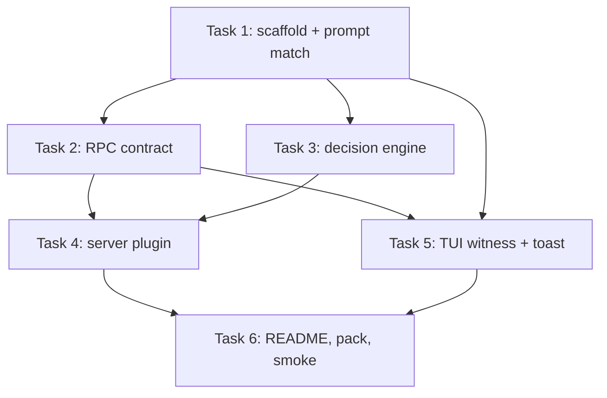

# Question-triggered Plan mode switching — Implementation Plan

**Goal:** an OpenCode plugin package that, in TUI sessions only, runs prompts ending with `?` in the `plan` agent and restores the previous agent on the next prompt, with a toast on every plugin-initiated switch.

**PRD:** docs/ae/2026-11-08-auto-plan-mode/PRD.md. The PRD governs intent; this plan argues from it. Where they conflict, the PRD wins and the plan must be corrected.

## Technical decisions

- **One npm package, three parts** (`src/index.ts` server, `src/tui.ts` TUI, `src/rpc.ts` shared contract) per the official part layout; OpenCode loads the TUI part automatically alongside the server part ("one entry loads every part"). Package name `opencode-auto-switch`; server plugin `id: "auto-plan"`; TUI part `id: "auto-plan-tui"`; RPC definition `id: "auto-plan"`.
- **TUI-origin detection (PRD's deferred risk, resolved):** the prompt hook has no caller-provenance field, so the TUI part witnesses which sessions belong to a TUI — via a `prompt.footer` slot claim (its reactive input carries `sessionID`) plus an initial `ui.tabs.list()` snapshot — and pushes them to the server part over the RPC method `reportSessions`. The prompt hook acts only on witnessed sessions. Sessions from `opencode run`/SDK are never witnessed, which is exactly AC-6; child sessions are additionally guarded by `parentID`. Worst case on a race (prompt admitted before the first push) is a missed switch, never a wrong one.
- **Switch + restore via `ctx.session.switchAgent({ sessionID, agent })`.** `Session.Info.agent` is optional ("session default"); `switchAgent` requires a concrete string, so the remembered agent is `info.agent ?? "build"` (the built-in default primary agent).
- **State lives on the session record** under `info.metadata["opencode-auto-plan"] = { agent: <remembered> }`, written via `ctx.session.update` (verified: `SessionUpdateInput` accepts a metadata map). No plugin-side memory to lose across server restarts; clearing the key restores "no state".
- **Give-up rule is evaluated from current state, no event subscription:** at each witnessed prompt, if `metadata["opencode-auto-plan"]` exists but the session's current agent is no longer `plan`, the user moved the agent manually — clear the state and never restore. Manual control always wins (PRD decision 2).
- **Decision logic is a pure function** (`decide()` in `src/state.ts`): `(session info, prompt text, witness) → action list`. All PRD behaviors are unit-tested there; the two wiring parts only execute actions.
- **Never block admission:** a throwing prompt hook prevents the user's prompt from being admitted ("If preparation fails … OpenCode does not admit the prompt"). Every hook path is wrapped best-effort — on error, log a warning and leave the prompt untouched.
- **Toast channel:** server part emits the RPC event `switched { sessionID, from, to, reason }` only for plugin-initiated switches; the TUI part renders `ui.toast.show({ title: "auto-plan", message, variant: "info" })`. Exact copy: question → `Plan mode — prompt ended with "?"`; restore → `Restored ${to}`.
- **Toolchain:** TypeScript compiled by OpenCode's Bun runtime at load time (ship `.ts` sources in `exports`, as the official example does); tests run on Node v22 with **vitest** (no Bun on this machine); typecheck with `tsc --noEmit` (`module: ESNext`, `moduleResolution: bundler`, `target: ES2022`, `strict`, `skipLibCheck`). The TUI wiring test stubs `@opencode/plugin/tui` via a vitest alias so the TUI part is testable without OpenCode's optional TUI peer deps (`@opentui/*`).
- **Versions:** dependency `@opencode/plugin: ^2.2.6` (matches the installed opencode v2.2.6); devDeps `typescript ^5.9`, `vitest ^3.0`.

## Global constraints

| Constraint | Value |
|---|---|
| Form factor | OpenCode plugin (JS/TS module) |
| Distribution | Open-source GitHub repo; installable via `plugins` in `opencode.json(c)` (npm package / GitHub reference) |
| Trigger rule | Prompt text ends with `?` after trimming trailing whitespace |
| Scope | Interactive TUI main session only — not `opencode run`, not SDK/server-API sessions, not child/subagent sessions |
| Target mode | Built-in `plan` agent |
| License | MIT |
| Compatibility | OpenCode v2.2.x, `@opencode/plugin` ^2.2.6 |

## Review focus

- Never-throw guarantee in the prompt hook: any failure must degrade to "no switch", never block admission.
- State machine give-up edge: user manually cycles plan → other → plan between prompts; plugin may then restore on the next non-`?` prompt, overriding the manual return — accepted limitation, verify it is at least *safe* (restores to the remembered agent, never blocks, never toasts spuriously).
- Witness staleness: a session witnessed by a TUI that has since closed can still auto-switch if prompted again via `opencode run --session <id>` — accepted limitation; confirm it cannot affect never-witnessed sessions.
- Metadata merge: `session.update` replaces the whole metadata map — always spread existing `info.metadata` before writing, so user-set keys survive.
- RPC event delivery is live-only: a TUI that is disconnected misses `switched` events (no toast) — switch behavior itself is unaffected.

## Execution strategy

- **Waves** — each wave runs once the previous one lands; riskiest tasks first:
  - Wave 1: Task 1
  - Wave 2: Task 2, Task 3 (parallel-safe — disjoint files, Task 3 consumes only Task 1's interface)
  - Wave 3: Task 4, Task 5 (parallel-safe — disjoint files, both consume only Tasks 2–3 interfaces)
  - Wave 4: Task 6 — integration owner: Task 6 runs the full suite and the manual smoke across both parts
- Default is sequential execution in wave order; parallel marks are opt-in per task.

---

### Task 1: Scaffold the plugin package and the `?` prompt matcher

**Description:** Create the npm package `opencode-auto-switch` in the repo root with the official three-part export layout (`.` → `src/index.ts`, `./rpc` → `src/rpc.ts`, `./tui` → `src/tui.ts`), MIT `LICENSE`, `tsconfig.json`, vitest config, and npm scripts (`test`, `typecheck`). Implement the pure trigger matcher: `isQuestionPrompt(text: string): boolean` — trim trailing whitespace (spaces, tabs, newlines) from the end of `text`, then return whether what remains ends with `?`. Empty/whitespace-only text is not a question. This nails the PRD trigger rule and proves the toolchain.

**Size:** one behavior (trigger rule) plus mechanical scaffolding; ~120 lines.

**Dependencies:** none

**Files:**
- Create: `package.json`, `tsconfig.json`, `vitest.config.ts`, `LICENSE`, `README.md` (stub), `.gitignore`
- Create: `src/index.ts` (placeholder `Plugin.define` with `id: "auto-plan"` and empty setup), `src/prompt-check.ts`, `src/prompt-check.test.ts`
- Create: `src/rpc.ts`, `src/tui.ts` (empty placeholder modules so the export map resolves)

**Interfaces:**
- Produces: `isQuestionPrompt(text: string): boolean` from `src/prompt-check.ts` — exact name and signature, consumed by Task 3.
- Produces: working `npm test` (vitest) and `npm run typecheck` (tsc --noEmit).

**Acceptance criteria:**
- [ ] AC-1: `isQuestionPrompt("how does auth work?")` is `true`; `"why?"` is `true`.
- [ ] AC-2: trailing whitespace does not defeat the trigger: `"why does this break? "`, `"why?\n"`, `"why?\t\n"` are all `true`.
- [ ] AC-3: `"hello"`, `"what is 1+1"`, `""`, `"   "` are `false`; a `?` that is not final (`"why? not"`) is `false`.
- [ ] AC-4: `package.json` exports map contains `.`, `./rpc`, `./tui` pointing at `src/*.ts`; license field is `MIT`.

**Verification:**

Run: `npm install && npm test && npm run typecheck`
Expected: install succeeds; vitest reports all prompt-check tests passing; tsc exits 0 with no errors.

**Parallel:** no — root of the graph.

**Review focus:** export map matches the official part layout exactly; matcher handles `\r\n` and unicode whitespace after `?` via the trim.

### Task 2: Define the RPC contract

**Description:** Implement `src/rpc.ts` with `Rpc.define` (from `@opencode/plugin/rpc`): definition `id: "auto-plan"`, one method `reportSessions` with input `{ sessionIDs: string[] }` (items are strings; `additionalProperties: false`; empty array allowed) and no output, and one event `switched` with schema `{ sessionID: string, from: string, to: string, reason: "question" | "restore" }` (all required, `additionalProperties: false`). Both parts import this one contract, so the server's implementation and the TUI's calls are type-checked against the same shapes.

**Size:** one cognitive unit (the typed contract); ~50 lines.

**Dependencies:** Task 1

**Files:**
- Modify: `src/rpc.ts`
- Create: `src/rpc.test.ts`

**Interfaces:**
- Produces: `export const AutoPlanRpc` — the `Rpc.PortableDefinition` consumed by Task 4 (`ctx.rpc.register(AutoPlanRpc, …)`) and Task 5 (`context.client.rpc(AutoPlanRpc)`).

**Acceptance criteria:**
- [ ] AC-1: the definition's method input schema rejects a payload whose `sessionIDs` contains a non-string (`{ sessionIDs: [1] }` invalid) and accepts `{ sessionIDs: ["ses_1", "ses_2"] }`.
- [ ] AC-2: the `switched` event schema rejects a payload missing `reason` or with `reason: "other"`, and accepts a full valid payload.

**Verification:**

Run: `npm test -- src/rpc.test.ts`
Expected: schema-validation tests pass (validate sample payloads against the JSON Schemas with a tiny local validator helper in the test — no new runtime dependency).

**Parallel:** yes — with Task 3. Disjoint files (`src/rpc.ts` + its test vs `src/state.ts` + its test); no shared interfaces beyond Task 1's toolchain. Task 6 integrates.

**Review focus:** schemas are strict (`additionalProperties: false` everywhere) — the contract is the plan's most stable interface; loosening it later is a breaking change.

### Task 3: Implement the pure decision engine

**Description:** Implement `decide(input: DecideInput): Action[]` in `src/state.ts` — the full PRD state machine with no I/O. `DecideInput = { text: string, witnessed: boolean, parentID?: string, agent: string, remembered?: string }` where `agent` is the session's current agent (`info.agent ?? "build"`) and `remembered` is the remembered agent from `info.metadata["opencode-auto-plan"]?.agent` when state exists (callers pass `remembered: undefined` when no state). Actions: `{ type: "switch-to-plan", rememberedAgent: string }`, `{ type: "restore", agent: string }`, `{ type: "clear-state" }` (also emitted alongside `switch-to-plan`'s state write is implied — `clear-state` is only ever produced alone). Rules: (1) not witnessed or has `parentID` → no actions; (2) state exists but `agent !== "plan"` → `clear-state` only (user moved manually — give up); (3) question and `agent !== "plan"` → `switch-to-plan` with `rememberedAgent: agent`; (4) question and already `plan` (with or without state) → none; (5) non-question with state and `agent === "plan"` → `restore` with the remembered agent; (6) non-question without state → none.

**Size:** one behavior (the whole decision state machine); ~80 lines plus tests.

**Dependencies:** Task 1 (uses `isQuestionPrompt`)

**Files:**
- Create: `src/state.ts`, `src/state.test.ts`

**Interfaces:**
- Consumes: `isQuestionPrompt` from `src/prompt-check.ts`.
- Produces: `decide(input: DecideInput): Action[]`, exported types `DecideInput`, `Action` — exact shapes above, consumed by Task 4.

**Acceptance criteria:**
- [ ] AC-1 (PRD AC-1/AC-2 path): witnessed, no parent, `agent: "build"`, no state, question text → exactly one `switch-to-plan` with `rememberedAgent: "build"`.
- [ ] AC-2 (PRD AC-2 path): witnessed, `agent: "plan"`, `remembered: "build"`, non-question → exactly one `restore` with `agent: "build"`.
- [ ] AC-3 (PRD AC-3 path): `witnessed: false` → no actions, even for question text; `parentID: "ses_parent"` → no actions, even when witnessed.
- [ ] AC-4 (PRD AC-4 path): witnessed, `agent: "plan"`, no state, question → no actions; then non-question → no actions.
- [ ] AC-5 (PRD AC-5 path): witnessed, state present (`remembered: "build"`), `agent: "review"`, question or non-question → `clear-state` only, never a restore or a second switch; a subsequent fresh question then yields `switch-to-plan` with `rememberedAgent: "review"`.
- [ ] AC-6: action arrays are mutually exclusive — `switch-to-plan` never appears with `restore` or `clear-state`.

**Verification:**

Run: `npm test -- src/state.test.ts`
Expected: all decision-table tests pass; vitest reports no failures.

**Parallel:** yes — with Task 2. Disjoint files; consumes only Task 1's interface. Task 6 integrates.

**Review focus:** the give-up rule (AC-5) — confirm the plan's rule set matches the PRD's "manual choices are never overridden" in every branch.

### Task 4: Wire the server plugin

**Description:** Implement `src/index.ts`: `Plugin.define({ id: "auto-plan", setup })`. In setup: (a) register the RPC — `ctx.rpc.register(AutoPlanRpc, { reportSessions })` where the handler unions the given `sessionIDs` into an in-memory witnessed `Set<string>` (never removes — several TUI instances can push concurrently); (b) register `ctx.session.hook("prompt", handler)`. The handler: resolve `sessionID = event.sessionID`; if not in the witnessed set, return; fetch `info = await ctx.session.get({ sessionID })` inside try/catch — on fetch failure log a warning and return; build `DecideInput` (`text: event.prompt.text`, `witnessed: true`, `parentID: info.parentID`, `agent: info.agent ?? "build"`, `remembered: info.metadata?.["opencode-auto-plan"]?.agent`); run `decide`; execute actions: `switch-to-plan` → `ctx.session.switchAgent({ sessionID, agent: "plan" })` + `ctx.session.update({ sessionID, metadata: { ...info.metadata, "opencode-auto-plan": { agent: rememberedAgent } } })` + emit `switched { sessionID, from: rememberedAgent, to: "plan", reason: "question" }` via the registration's `events.emit`; `restore` → `switchAgent({ sessionID, agent })` + update metadata with the `"opencode-auto-plan"` key removed + emit `switched { …, reason: "restore" }`; `clear-state` → metadata update removing the key only. Every execution step is individually guarded so the hook never throws (log-and-continue). Setup returns a cleanup that disposes the RPC registration.

**Size:** one behavior (executing the decision engine against the live session); ~130 lines plus tests.

**Dependencies:** Task 2, Task 3

**Files:**
- Modify: `src/index.ts`
- Create: `src/index.test.ts`, `test/fakes.ts` (typed in-memory fakes for the `ctx.session` subset — `get`/`switchAgent`/`update`/`hook` — RPC registration capture, and event-emit capture)

**Interfaces:**
- Consumes: `decide`/`Action` (Task 3), `AutoPlanRpc` (Task 2).
- Produces: the server plugin default export (the package's `.` entry) — consumed by Task 6's packaging and smoke.

**Acceptance criteria:**
- [ ] AC-1 (PRD AC-1): witnessed non-plan session + question prompt → hook performs `switchAgent(…, "plan")`, writes metadata state `{ agent: "build" }`, and emits one `switched` event with `reason: "question"`.
- [ ] AC-2 (PRD AC-2): the following non-question prompt on that session → `switchAgent(…, "build")`, metadata key removed, one `switched` event with `reason: "restore"`.
- [ ] AC-3 (PRD AC-3): a prompt whose session has `parentID` set → no `switchAgent`, no metadata write, no event, even when witnessed; an unwitnessed session (simulating `opencode run`/SDK, PRD AC-6) → same no-ops, and `ctx.session.get` is not even called.
- [ ] AC-4 (PRD AC-4): plan session without state asking a question → zero side effects (no switch, no write, no event).
- [ ] AC-5 (PRD AC-5): state present but current agent moved to `review` → metadata key cleared only; no switch, no event.
- [ ] AC-6 (never-throw): `ctx.session.get` rejecting, `switchAgent` rejecting, and `events.emit` rejecting each leave the hook resolved (not rejected) and the prompt draft untouched (`event.prompt.text` unmodified in all paths).
- [ ] AC-7: unwitnessed sessions never enter the hook's action path even when their text ends with `?`.

**Verification:**

Run: `npm test -- src/index.test.ts`
Expected: all wiring tests pass against the fakes; vitest reports no failures.

**Parallel:** yes — with Task 5. Disjoint files (`src/index.ts` + `src/index.test.ts` + `test/fakes.ts` vs `src/tui.ts` + `src/witness.ts` + their tests). Task 6 integrates and runs the combined suite.

**Review focus:** the never-throw guards cover every await, including metadata write and event emit; metadata updates always spread `info.metadata` first.

### Task 5: Wire the TUI witness and toasts

**Description:** Implement `src/witness.ts` (pure) and `src/tui.ts` (wiring). `witness.ts` exports `createWitness()` with `add(sessionID: string): boolean` (dedupe), `snapshot(): string[]`, and `onChange(cb: () => void): () => void` — the change callback fires after an `add` that grew the set. `src/tui.ts` is `Plugin.define({ id: "auto-plan-tui", setup(context) })`: create the witness; claim the `prompt.footer` slot with a render that reads `input.sessionID` and (when defined) `witness.add`s it, rendering nothing visual; take an initial `context.ui.tabs.list()` snapshot and add each tab's `sessionID`; push via `const autoPlan = context.client.rpc(AutoPlanRpc)` calling `autoPlan.reportSessions({ sessionIDs: witness.snapshot() })` — on setup, after every witness change (coalesced with a microtask so a burst of slot renders results in one push), and on `server.connected` (via `context.data.on("server.connected", …)`, re-pushing after a server restart); subscribe `autoPlan.events.on("switched", (event) => context.ui.toast.show({ title: "auto-plan", message: event.data.reason === "restore" ? `Restored ${event.data.to}` : `Plan mode — prompt ended with "?"`, variant: "info" }))`; setup returns a cleanup that unclaims the slot, unsubscribes listeners, and disposes the push scheduling. Toast messages are exactly the two strings above.

**Size:** one behavior (witnessing + surfacing switches); ~110 lines plus tests.

**Dependencies:** Task 1, Task 2

**Files:**
- Create: `src/witness.ts`, `src/witness.test.ts`, `src/tui.ts`, `src/tui.test.ts`
- Modify: `vitest.config.ts` (alias `@opencode/plugin/tui` → `test/tui-stub.ts` for the TUI wiring test only)

**Interfaces:**
- Consumes: `AutoPlanRpc` (Task 2).
- Produces: `createWitness()` from `src/witness.ts`; the TUI part default export (package's `./tui` entry) — consumed by Task 6's smoke.

**Acceptance criteria:**
- [ ] AC-1: witness dedupes — adding the same sessionID twice grows the set once and fires the change callback once.
- [ ] AC-2: a slot render with a defined `sessionID` adds it and schedules exactly one coalesced `reportSessions` push containing the full snapshot; a render with `sessionID: undefined` adds nothing.
- [ ] AC-3: a `switched` event with `reason: "question"` calls `ui.toast.show` exactly once with title `auto-plan`, message `Plan mode — prompt ended with "?"`, variant `info`; `reason: "restore"` produces message `Restored build` when `to` is `build`; no `switched` event → no toast call.
- [ ] AC-4: cleanup disposes the slot claim, the `switched` listener, and the `server.connected` listener (no further toast or push after cleanup).

**Verification:**

Run: `npm test -- src/witness.test.ts src/tui.test.ts`
Expected: witness and TUI wiring tests pass with the alias stub and an in-memory fake TUI context (client rpc capture, ui.toast capture, data.on capture).

**Parallel:** yes — with Task 4. Disjoint files; consumes only Task 2's contract. Task 6 integrates.

**Review focus:** coalescing must not drop a final push (flush scheduled pushes on cleanup and on `server.connected`); toast copy matches the decided strings exactly.

### Task 6: Publishability and end-to-end smoke

**Description:** Finalize the package for distribution and verify the whole feature across both parts. Complete `README.md`: what the plugin does (one paragraph), install (published name and local path `"plugins": ["./<path>"| "opencode-auto-switch"]` in `opencode.json(c)`), behavior table (question → plan with toast; next non-question → restore with toast; manual agent change → plugin stands down; CLI/SDK/subagents unaffected), compatibility (OpenCode v2.2.x), MIT license note, and a maintainer smoke checklist. Run the full automated suite and `npm pack`; then perform the documented manual smoke against a real `opencode` TUI with the plugin linked locally.

**Size:** one deliverable (shippable package + verified feature); documentation plus validation, no logic.

**Dependencies:** Task 4, Task 5

**Files:**
- Modify: `README.md`, `package.json` (final `name`, `version: 0.1.0`, `description`, `keywords`, `repository`, `files: ["src"]`, `license`)

**Interfaces:**
- Consumes: the complete package (Tasks 1–5).
- Produces: the publishable package artifact (`npm pack` tarball).

**Acceptance criteria:**
- [ ] AC-1: `npm test && npm run typecheck` pass with zero failures across all tasks' suites.
- [ ] AC-2: `npm pack` succeeds and the tarball contains `src/`, `README.md`, `LICENSE`, `package.json` (publishable per the official plugin layout).
- [ ] AC-3 (PRD AC-1/2/7 smoke): in a real TUI with the plugin linked, from `build`, sending `how does auth work?` shows the toast `Plan mode — prompt ended with "?"` and the TUI agent indicator switches to `plan`; sending `summarize` shows `Restored build` and returns the indicator to `build`.
- [ ] AC-4 (PRD AC-6 smoke): `opencode run "why does this fail?"` in the linked project produces no toast and no agent change in the TUI session.

**Verification:**

Run: `npm test && npm run typecheck && npm pack`
Expected: suites green; tsc clean; `opencode-auto-switch-0.1.0.tgz` created listing `src/` contents.

Run (manual, documented in README): the four smoke steps above against `opencode` v2.2.6 with `"plugins": ["<repo path>"]`.
Expected: toasts and agent switches exactly as in AC-3/AC-4; no toast for CLI runs.

**Parallel:** no — integration owner; runs everything.

**Review focus:** README claims must match actual behavior (no promised options — the plugin has none); version compatibility statement is `^2.2.6`.

## PRD coverage

| PRD criterion | Covered by |
|---|---|
| AC-1 (? → plan before running) | Task 3 AC-1, Task 4 AC-1, Task 6 AC-3 |
| AC-2 (restore on next non-?) | Task 3 AC-2, Task 4 AC-2, Task 6 AC-3 |
| AC-3 (subagents unaffected) | Task 3 AC-3, Task 4 AC-3 |
| AC-4 (already plan → no change) | Task 3 AC-4, Task 4 AC-4 |
| AC-5 (manual change → stand down) | Task 3 AC-5, Task 4 AC-5 |
| AC-6 (CLI/SDK never switch) | Task 4 AC-3/AC-7, Task 6 AC-4 |
| AC-7 (toast on switches only) | Task 5 AC-3, Task 4 AC-1/AC-2 (events emitted only on switches) |
| G1 (? → plan) | Task 3 AC-1, Task 4 AC-1 |
| G2 (restore) | Task 3 AC-2, Task 4 AC-2 |
| G3 (subagents unaffected) | Task 3 AC-3, Task 4 AC-3 |
| G4 (plugin absent → nothing changes) | Task 6 (hooks exist only inside the configured package; smoke installs it explicitly) |
| G5 (CLI/SDK unaffected) | Task 4 AC-3, Task 6 AC-4 |
| G6 (never silent) | Task 5 AC-3 |
| Constraint: trigger rule | Task 1 AC-1..3 |
| Constraint: MIT + distribution layout | Task 1 AC-4, Task 6 AC-2 |
